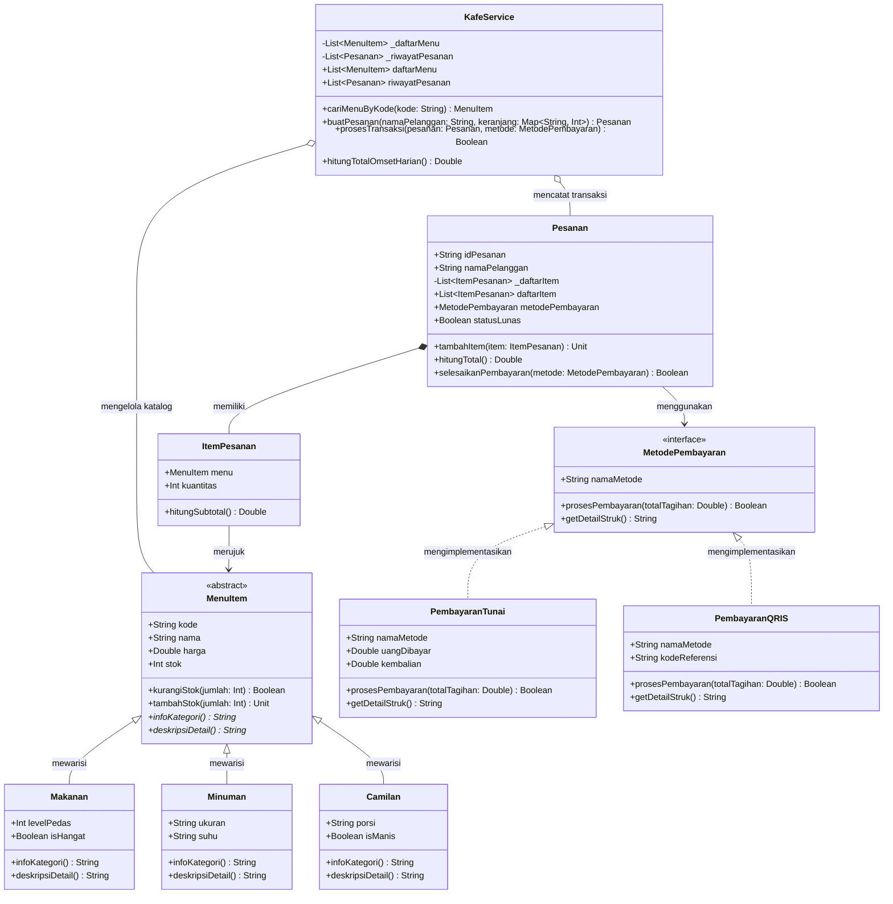

# ☕ KopiKita POS — Sistem Kasir Kafe Cerdas (Smart Coffee Shop POS)

## 1. Deskripsi Proyek

**KopiKita POS** adalah aplikasi *Point of Sale* (POS) berbasis *Command Line Interface* (CLI) yang dibangun menggunakan bahasa pemrograman **Kotlin** dengan pendekatan **Object-Oriented Programming (OOP)**.

Aplikasi ini dirancang untuk menyelesaikan permasalahan operasional harian yang sering terjadi pada pencatatan kasir kafe konvensional, meliputi:
* **Pencatatan Pesanan Terstruktur:** Menghindari kesalahan perhitungan manual saat pelanggan memesan berbagai varian menu (makanan, minuman, dan camilan) dalam jumlah beragam.
* **Kalkulasi & Validasi Stok Otomatis:** Mencegah terjadinya *overselling* (menjual menu yang stoknya sudah habis) dengan melakukan validasi ketersediaan stok secara *real-time* sebelum transaksi diproses.
* **Manajemen Pembayaran Multi-Metode:** Mendukung fleksibilitas transaksi melalui pembayaran **Tunai** (lengkap dengan validasi nominal dan kalkulasi kembalian otomatis) maupun **QRIS** (verifikasi pembayaran digital).
* **Rekapitulasi Laporan Pendapatan:** Menyediakan ringkasan omset harian secara akurat berdasarkan transaksi yang telah berhasil diselesaikan.

---

## 2. Anggota Kelompok

Proyek ini dikembangkan secara kolaboratif oleh 6 mahasiswa dengan pembagian peran sebagai berikut:

| No | Nama Lengkap | NIM | Peran Resmi |
| :---: | :--- | :---: | :--- |
| 1 | **Fatih Ahsan** | 225443033 | Project Lead / Arsitek |
| 2 | **Syaroful Haidar Sudaryono** | 225443051 | Domain Developer |
| 3 | **Mochammad Faishal Ghani Iskandar** | 225443040 | Business Logic Developer |
| 4 | **Muhammad Adil Abdirrahim** | 225443042 | UI / CLI Developer |
| 5 | **Nasywan Aziz** | 225443048 | QA + Data & Persistence |
| 6 | **Febriansyah** | 225443035 | DevOps |

---

## 3. User Story & Kriteria Diterima (Acceptance Criteria)

Berikut adalah daftar kebutuhan fungsional utama sistem dari sudut pandang pengguna:

| ID | User Story | Kriteria Diterima (Acceptance Criteria) |
| :---: | :--- | :--- |
| **US-01** | **Sebagai** Kasir, **saya ingin** melihat daftar katalog menu beserta harga dan sisa stoknya, **agar** saya dapat menginformasikan ketersediaan produk kepada pelanggan dengan cepat. | • Sistem menampilkan seluruh daftar menu yang dikelompokkan/dilengkapi informasi kategori (`Makanan`, `Minuman`, `Camilan`).<br>• Setiap item menampilkan kode menu, nama, atribut spesifik varian, harga satuan, dan jumlah stok terkini.<br>• Menu dengan stok `0` tetap tampil dengan keterangan `[HABIS]`. |
| **US-02** | **Sebagai** Kasir, **saya ingin** membuat pesanan baru dengan menambahkan beberapa menu beserta kuantitasnya, **agar** sistem dapat menghitung subtotal dan total tagihan pelanggan secara otomatis. | • Kasir dapat memilih satu atau lebih menu berdasarkan kode menu dan menentukan jumlah beli (`qty > 0`).<br>• Sistem menghitung subtotal per item (`harga × kuantitas`) dan menjumlahkan total tagihan pesanan secara otomatis.<br>• Sistem menampilkan ringkasan keranjang pesanan sebelum masuk ke tahap pembayaran. |
| **US-03** | **Sebagai** Kasir, **saya ingin** memilih metode pembayaran (Tunai atau QRIS) saat menyelesaikan transaksi, **agar** proses pelunasan sesuai dengan preferensi pelanggan dan stok menu otomatis berkurang. | • Kasir dapat memilih opsi pembayaran **Tunai** atau **QRIS**.<br>• Untuk **Tunai**: sistem memvalidasi uang bayar $\ge$ total tagihan dan menghitung kembalian secara otomatis.<br>• Untuk **QRIS**: sistem menampilkan kode referensi transaksi dan memverifikasi pelunasan sebesar nominal pas.<br>• Setelah pembayaran berhasil, stok masing-masing menu otomatis berkurang sesuai kuantitas pesanan dan transaksi tercatat ke riwayat. |
| **US-04** | **Sebagai** Manajer, **saya ingin** sistem menolak pembuatan atau penambahan item pesanan apabila stok menu tidak mencukupi atau habis, **agar** tidak terjadi selisih inventaris dan kekecewaan pelanggan. | • Jika kuantitas yang diminta melebihi sisa stok (`qty > stok`) atau `stok == 0`, sistem menolak item tersebut dan menampilkan pesan peringatan sisa stok yang tersedia.<br>• Stok di dalam inventaris tidak berubah apabila transaksi gagal atau ditolak. |
| **US-05** | **Sebagai** Manajer, **saya ingin** melihat rekap laporan omset harian kafe, **agar** saya dapat memantau total pendapatan dan jumlah transaksi yang berhasil hari ini. | • Sistem menampilkan total jumlah transaksi sukses pada hari berjalan.<br>• Sistem menampilkan total akumulasi pendapatan (omset) dalam Rupiah.<br>• Sistem menampilkan daftar ringkas riwayat pesanan beserta metode pembayaran yang digunakan. |

---

## 4. Diagram Kelas UML (Class Diagram)

Berikut adalah rancangan arsitektur berorientasi objek **KopiKita POS** dalam format Mermaid:



---

## 5. Penerapan 4 Pilar OOP

Implementasi empat pilar utama pemrograman berorientasi objek dalam basis kode Kotlin **KopiKita POS**:

| Pilar OOP | Lokasi / Komponen Kode | Bukti Penerapan Nyata di Kode Program |
| :--- | :--- | :--- |
| **Abstraksi** (*Abstraction*) | `abstract class MenuItem` & `interface MetodePembayaran` | • `MenuItem` mendefinisikan kerangka dasar produk kafe beserta kontrak abstrak `infoKategori()` dan `deskripsiDetail()` tanpa dapat diinstansiasi langsung.<br>• `MetodePembayaran` menyembunyikan detail teknis pemrosesan pembayaran di balik kontrak `prosesPembayaran(totalTagihan: Double): Boolean`. |
| **Enkapsulasi** (*Encapsulation*) | Properti `stok` pada `MenuItem` & koleksi `private` di `KafeService` / `Pesanan` | • Properti `var stok: Int` menggunakan `protected set` sehingga nilai stok tidak bisa diubah sembarangan dari luar hierarki kelas, melainkan wajib melalui validasi method `kurangiStok()`.<br>• Daftar menu (`_daftarMenu`), item pesanan (`_daftarItem`), dan riwayat transaksi (`_riwayatPesanan`) disimpan sebagai `private val MutableList` dan diekspos keluar hanya sebagai `List` (*read-only*). |
| **Pewarisan** (*Inheritance*) | `Makanan`, `Minuman`, `Camilan` mewarisi `MenuItem` | • Ketiga subkelas mewarisi atribut umum (`kode`, `nama`, `harga`, `stok`) serta logika pengelolaan stok dari `MenuItem`, sambil menambahkan atribut spesifik masing-masing (misal `suhu` & `ukuran` pada `Minuman`, `levelPedas` pada `Makanan`). |
| **Polimorfisme** (*Polymorphism*) | `KafeService` & `Pesanan` | • Katalog menu disimpan dalam satu koleksi bertipe `List<MenuItem>`, sehingga pemanggilan `menu.deskripsiDetail()` menghasilkan output berbeda sesuai tipe aktual objek (`Makanan`, `Minuman`, atau `Camilan`).<br>• `Pesanan.selesaikanPembayaran(metode: MetodePembayaran)` memproses `PembayaranTunai` maupun `PembayaranQRIS` secara seragam melalui satu antarmuka tanpa percabangan tipe kelas manual. |

---

## 6. Panduan Cara Menjalankan (How to Run)

Pastikan perangkat Windows telah terpasang **JDK 17+** (untuk menjalankan secara lokal) atau **Docker Desktop** (untuk menjalankan via kontainer).

### A. Menjalankan Aplikasi Secara Lokal (Windows)
Buka **PowerShell** atau **Command Prompt (CMD)** pada direktori utama proyek, lalu jalankan perintah berikut:

```powershell
.\gradlew.bat run --console=plain
```

### B. Menjalankan Pengujian Otomatis (Unit Test)
Untuk menjalankan seluruh rangkaian *unit test* JUnit 5 dan memverifikasi logika bisnis:

```powershell
.\gradlew.bat test
```

### C. Menjalankan Aplikasi Menggunakan Docker (Bonus +10)
Pastikan layanan **Docker Desktop** sudah aktif, lalu jalankan aplikasi secara interaktif di dalam kontainer:

```powershell
docker compose run --rm kopikita-app
```

---

## 7. Skenario Unit Test

Pengujian otomatis menggunakan **JUnit 5** disusun oleh **QA (Nasywan Aziz)** untuk memastikan seluruh kriteria penerimaan (*Acceptance Criteria*) terpenuhi:

| Kode Test | Nama Skenario Pengujian | Referensi US | Hasil yang Diharapkan |
| :--- | :--- | :---: | :--- |
| **TC-01** | `testTampilkanKatalogMenuLengkap` | US-01 | Seluruh varian menu (`Makanan`, `Minuman`, `Camilan`) termuat dengan informasi harga, stok, dan deskripsi polimorfik yang sesuai. |
| **TC-02** | `testBuatPesananMultiItemDanHitungTotal` | US-02 | Pesanan dengan beberapa jenis item dan kuantitas berbeda menghitung subtotal dan total tagihan secara akurat. |
| **TC-03** | `testPembayaranTunaiBerhasilDanHitungKembalian` | US-03 | Transaksi tunai dengan nominal bayar melebihi tagihan berhasil, kembalian terhitung tepat, dan stok menu berkurang sesuai pesanan. |
| **TC-04** | `testPembayaranTunaiGagalUangKurang` | US-03 | Transaksi tunai dengan nominal bayar kurang dari total tagihan ditolak dan stok menu tidak berkurang. |
| **TC-05** | `testPembayaranQRISBerhasil` | US-03 | Transaksi melalui metode `PembayaranQRIS` terverifikasi lunas dan mengurangi stok menu secara otomatis. |
| **TC-06** | `testTolakPesananJikaStokHabis` | US-04 | Sistem melempar eksepsi / menolak pembuatan pesanan ketika menu yang dipilih memiliki `stok == 0`. |
| **TC-07** | `testTolakPesananJikaKuantitasMelebihiStok` | US-04 | Sistem menolak pesanan apabila kuantitas beli melebihi sisa stok yang tersedia di katalog. |
| **TC-08** | `testRekapLaporanOmsetHarian` | US-05 | Total omset harian dan jumlah transaksi sukses terakumulasi secara tepat dari seluruh pesanan yang berstatus lunas. |

---

## 8. Log Kontribusi Tim

Catatan pembagian tugas, progres pengerjaan, dan riwayat kontribusi masing-masing anggota tim dapat dilihat secara rinci pada berkas:
 **[CONTRIBUTORS.md](./CONTRIBUTORS.md)**