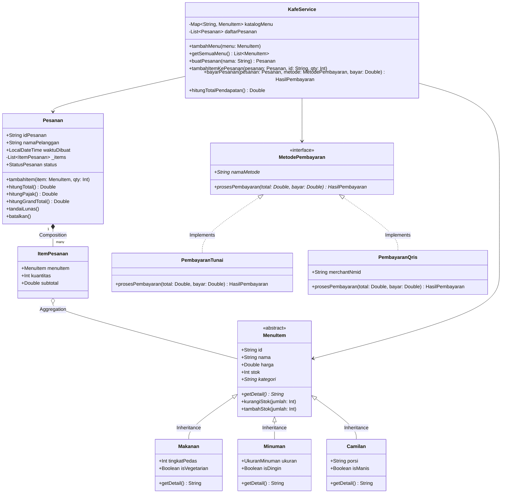

# ☕ KopiKita POS — Sistem Kasir Kafe Cerdas (Smart Coffee Shop POS)

Aplikasi Point of Sale (POS) & Manajemen Transaksi Kafe modern yang dibangun menggunakan bahasa pemrograman **Kotlin** dengan menerapkan prinsip murni **Pemrograman Berorientasi Objek (OOP)**, **Unit Testing (JUnit 5)**, **Containerization (Docker)**, dan **CI/CD (GitHub Actions)**.

Proyek ini disusun untuk memenuhi tugas **Bab 7: Proyek Mandiri Kelompok** pada mata kuliah Pemrograman Berorientasi Objek.

---

## 🎯 1. User Story & Kriteria Diterima (Acceptance Criteria)

| ID | User Story (Sebagai ..., saya ingin ..., agar ...) | Kriteria Diterima (*Acceptance Criteria*) |
| :---: | :--- | :--- |
| **US-01** | Sebagai **Kasir**, saya ingin melihat katalog seluruh menu yang dikelompokkan berdasarkan kategori (Makanan, Minuman, Camilan), agar dapat memberikan rekomendasi kepada pelanggan. | Menampilkan daftar tabel menu lengkap dengan ID, Nama, Harga, Stok, dan Detail spesifik kategori tanpa ada data yang terpotong. |
| **US-02** | Sebagai **Kasir**, saya ingin membuat transaksi pesanan baru dan menambahkan item dengan jumlah kuantitas tertentu, agar pelanggan dapat memesan beberapa hidangan sekaligus. | Kuantitas harus valid ($>0$), total harga terakumulasi secara otomatis, dan stok menu langsung berkurang sesuai pesanan. |
| **US-03** | Sebagai **Kasir**, saya ingin memilih metode pembayaran (Tunai atau QRIS), agar proses pembayaran fleksibel sesuai preferensi pelanggan. | Pembayaran tunai menghitung uang kembalian; pembayaran dengan uang kurang otomatis ditolak dengan pesan error yang jelas. |
| **US-04** | Sebagai **Manajer Kafe**, saya ingin sistem menolak pesanan jika kuantitas melebihi sisa stok gudang atau jika ID menu salah, agar pencatatan operasional tetap akurat. | Sistem melempar `StokTidakCukupException` atau `MenuTidakDitemukanException` dan aplikasi tidak mengalami *crash*. |
| **US-05** | Sebagai **Manajer Kafe**, saya ingin melihat laporan riwayat transaksi dan total omset/pendapatan kafe, agar dapat memantau performa penjualan harian. | Hanya pesanan dengan status `LUNAS` yang dihitung ke dalam total pendapatan; rincian transaksi tertata kronologis. |

---

## 📐 2. Class Diagram UML (Mermaid)



---

## 🏛️ 3. Penerapan 4 Pilar OOP

| Pilar OOP | Bukti Implementasi pada Kode |
| :--- | :--- |
| **Abstraksi (Abstraction)** | Menggunakan `abstract class MenuItem` dengan metode abstrak `getDetail()` serta `interface MetodePembayaran` untuk memisahkan kontrak perilaku dari implementasi detailnya. |
| **Enkapsulasi (Encapsulation)** | Properti `stok` pada `MenuItem` diproteksi (`protected set`). Pada kelas `Pesanan`, list item disimpan dalam `_items` privat dan diekspos melalui *public getter read-only*, serta status pesanan menggunakan `private set`. |
| **Pewarisan (Inheritance)** | Subclass `Makanan`, `Minuman`, dan `Camilan` mewarisi seluruh atribut dasar serta fungsi stok dari kelas induk `MenuItem`. |
| **Polimorfisme (Polymorphism)** | `MetodePembayaran` didefinisikan secara polimorfik (`PembayaranTunai` dan `PembayaranQris`). Service memperlakukan seluruh varian menu secara generik sebagai `MenuItem`. |

---

## 🛠️ 4. Panduan Menjalankan Proyek (DevOps)

### A. Prasyarat Lingkungan
* **JDK 21** atau lebih tinggi
* **Gradle 8.x** (atau gunakan `./gradlew`)
* **Docker & Docker Compose** (Opsional untuk container)

### B. Menjalankan Langsung via Gradle
```bash
# Clone repositori
git clone https://github.com/[Organisasi-Anda]/KopiKita-POS.git
cd KopiKita-POS

# Menjalankan Unit Test
./gradlew test

# Menjalankan Aplikasi CLI
./gradlew run --console=plain
```
*(Di Windows PowerShell, gunakan `.\gradlew.bat test` dan `.\gradlew.bat run --console=plain`)*

### C. Menjalankan Menggunakan Docker (Bonus Poin)
```bash
# Build dan jalankan interaktif di terminal container
docker compose run --rm kopikita-app
```

---

## 🧪 5. Skenario Pengujian (Unit Test)
Pengujian otomatis dilakukan pada berkas `src/test/kotlin/com/kopikita/KafeServiceTest.kt` dengan 7 skenario uji:
1. `testHitungTotalDanPajakPesanan`: Menghitung kalkulasi subtotal dan pajak resto 10%.
2. `testStokBerkurangSaatPesananBerhasil`: Memastikan stok item berkurang secara akurat.
3. `testStokTidakCukupMelemparException`: Memvalidasi bahwa `StokTidakCukupException` dilempar saat pesanan melebihi stok.
4. `testMenuTidakDitemukanMelemparException`: Memvalidasi bahwa `MenuTidakDitemukanException` dilempar jika ID tidak valid.
5. `testPembayaranTunaiUangKurangMelemparException`: Memvalidasi bahwa `PembayaranGagalException` dilempar saat uang tunai kurang.
6. `testPembayaranQrisSuksesDanStatusLunas`: Memverifikasi pembayaran QRIS berhasil mengubah status pesanan menjadi `LUNAS`.
7. `testBatalkanPesananMengembalikanStok`: Memastikan pembatalan pesanan mengembalikan kuantitas stok menu ke keadaan semula.

---

## 👥 6. Kontributor Proyek
Silakan merujuk ke berkas [CONTRIBUTORS.md](CONTRIBUTORS.md) untuk detail susunan tim dan log aktivitas harian.
